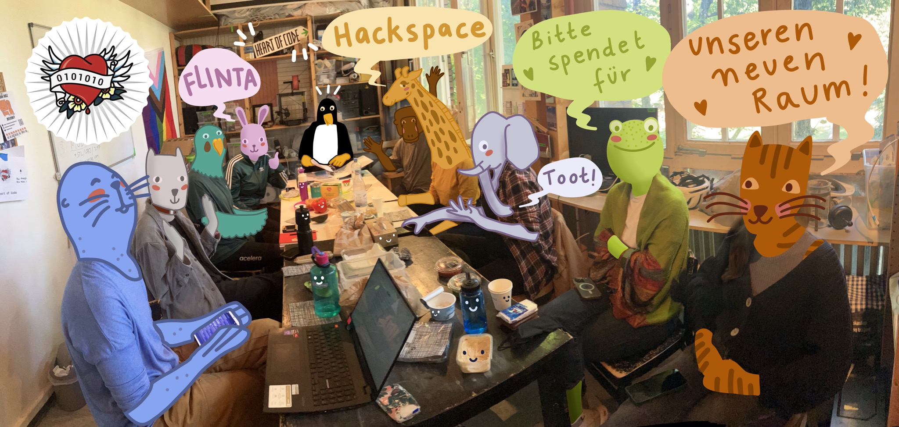

# Unterstütze uns!

Die Heart of Code wird von ehrenamtlicher Arbeit getragen. Kosten für unseren Raum, Infrastruktur und sonstige Ausgaben für Veranstaltungen und Workshops tragen die Mitglieder über Beiträge. Du möchtest unsere Arbeit unterstützen? Wir freuen uns über jede Spende und sind dankbar für alle die uns Unterstützen! Hier sind ein paar Optionen :\)

## Geld spenden

Du (oder deine Firma) könnt uns ganz klassisch Geld spenden! Wir sind gemeinnützig und können Spendenbescheinigungen ab 200 Euro ausstellen.

**Kontodaten:**

Name: Heart of Code e.V. \
IBAN: DE94 1005 0000 0191 6775 40 \
BIC: BELADEBEXXX \
Verwendungszweck: Spende \
Bank: Berliner Sparkasse

Für eine Spendenbescheinigung schreibst du uns am besten eine [Mail](mailto:hello@heartofcode.org?subject=Spendenbescheinigung) mit dem Datum und Betrag der Überweisung und dann (ganz wichtig!) dem vollständigen Namen und Anschrift für den Spendenbescheid. Den gibt's dann per Post.

### Haus der Statistik

Wir sind aktuell dabei Spenden für einen neuem Raum im Haus der Statistik zu sammeln. Wir freuen uns riesig wenn du uns dabei unterstützt!

Hier geht es zum Fundraiser mit allen Informationen: [www.betterplace.org/de/projects/189278](https://www.betterplace.org/de/projects/189278)

## Sachspenden

Du hast noch Raspberry Pis, Laptops, HDMI-Kabel oder anderen (funktionierenden) Tech-Kram bei dir rumliegen, den du nicht mehr brauchst? Oft können wir das Material für Workshops verwenden oder weiterverteilen. Schreib uns gern an und wir organisieren das!
