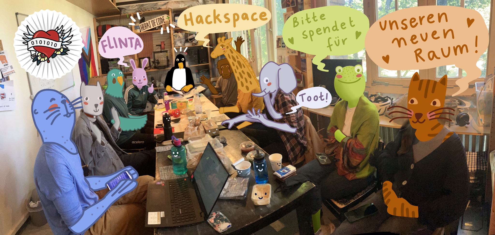

# Support us!

Heart of Code is run entirely on volunteering work. Members cover the costs of our space, infrastructure, and other expenses for events and workshops through their membership fees. You want to support our work? We appreciate every donation and are grateful to everyone who supports us! Here are some options :\)

## Donate money

You (or your company) can make a traditional monetary donation! We are a nonprofit organization and can issue donation receipts for amounts of 200 euros or more.

**Bank details:**

Name: Heart of Code e.V. \
IBAN: DE94 1005 0000 0191 6775 40 \
BIC: BELADEBEXXX \
Reference: Donation \

To receive a donation receipt, please send us an [email](mailto:hello@heartofcode.org?subject=Donation%20receipt) with the date and amount of the transfer, and then (very important!) your full name and address for the donation receipt. We’ll then send it to you by mail.

### Haus der Statistik

We are currently collecting donations for a new space in the Haus der Statistik. We would love if you could support us with that!

Here you can find our fundraiser and further information: [www.betterplace.org/en/projects/189278](https://www.betterplace.org/en/projects/189278)

## Donations in Kind

Do you have any Raspberry Pis, laptops, HDMI cables, or other (working) tech gear lying around that you no longer need? We can often use this equipment for workshops or pass it on to others. Feel free to contact us and we’ll make it happen!
