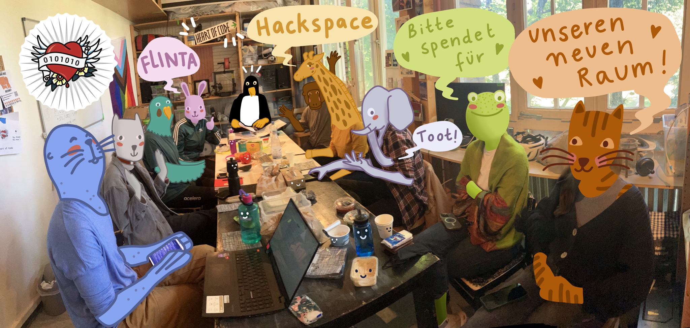

# Fundraising für die Genoss*innenschaftsanteile für das Haus der Statistik

Schön, dass du schon da bist! Für das Fundraising für einen neuen Raum benutzten wir die Spendenplattform [betterplace.org](https://www.betterplace.org/de). Leider braucht es noch etwas bis unser Projekt dort freigeschalten ist. Sobald das der Fall ist, wirst du über diesen Link ([heartofcode.org/fundraising](https://heartofcode.org/fundraising)) aber direkt zur passenden Seite weitergeleitet. Schaue also am besten in ein paar Tagen nochmal vorbei. Dann kann es fleißig mit dem Spenden losgehen. Wir freuen uns sehr. Danke für dein Engagement \:)

